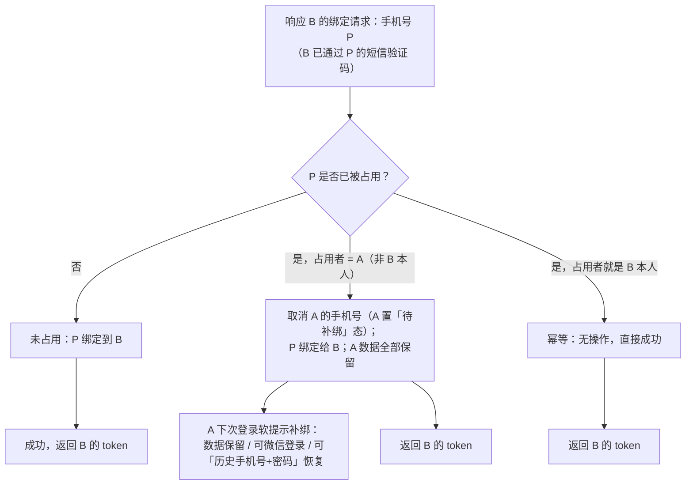

# TryBe 统一账号体系 v2 · 增量 PRD

> 文档类型：增量需求（Increment PRD）
> 作者：许清楚（Xiǎoqīngchǔ）· 产品经理
> 面向版本：TryBe Auth v2
> 关联文档：《统一账号体系设计.md》（现有，根因分析）
> 关联上游决策：D1（新命名空间 `/users/auth/**`）、D2（Web 验证码登录未注册自动注册）、D3（**手机号冲突统一规则：短信验证码是手机号归属的唯一裁决依据**）

---

## 修订记录

| 版本 | 日期 | 变更 |
|---|---|---|
| v2.1 | 2026-09-25 | §6 手机号冲突规则统一为 **D3**（短信验证码是手机号归属的唯一裁决依据），废止原「情况甲/情况乙」分支方案；§7 E5 口径更新（A 可用「历史手机号+密码」恢复登录 Web）；§8 Q1 作废、Q3 口径放宽（A 旧密码保留为「账号恢复凭据」）；新增 E10 边界 |
| v2.0 | 2026-09-24 | 初稿 |

---

## 0. 项目信息

| 项 | 内容 |
|---|---|
| Language | 简体中文 |
| 端 | ① 微信小程序（原生）② Web 创作者后台（React18 + Vite5 + TS + MUI v5）③ 后端 Spring Cloud 微服务 |
| 涉及后端模块 | `user-service`（主）、`TryBe-common`（短信公共能力）、`TryBe-gateway`（白名单） |
| Project Name | `trybe_auth_v2` |
| 交付物 | 本增量 PRD（需求层，不含表结构与接口设计） |

**原始需求复述**：小程序用微信注册的用户，第一次登录必须强制绑定手机号；Web 端支持「手机号+短信验证码」与「手机号+密码」两种登录，两者在发送验证码/提交前都必须先通过图形验证码；短信验证码每次请求间隔 60s；重新设计 user 表，把 openid 与手机号+密码从 user 表抽离，手机号加唯一约束；手机号绑定时若被占用则「清空原账号手机号、迁移给当前账号」；短信验证码能力尽量复用现有实现，模块冲突时提取到公共模块。

---

## 1. 产品目标与范围

### 1.1 产品目标（3 个正交目标）

| # | 目标 | 衡量标准（可验收） |
|---|---|---|
| G1 | **账号统一**：小程序与 Web 使用同一套账号数据，手机号成为唯一跨端锚点 | 同一真人在 Web 与小程序登录后，返回同一 `user_id` 与其全部业务数据 |
| G2 | **冲突有出路**：手机号归属冲突不再「死路一条」，可迁移、可释放，数据零丢失、账号不被锁死 | 冲突场景返回确定性结果（见 §6 决策表），任一账号均可继续登录 |
| G3 | **验证码安全与复用**：图形验证码 + 60s 间隔 + 三级限流落地，且最大化复用既有实现 | 所有发短信入口均前置图形验证码；无新增重复的短信/验证码基础设施 |

### 1.2 本次做（In Scope）

| 编号 | 内容 | 端 |
|---|---|---|
| S1 | user 表拆分：将 `openid`、`phone + password` 从 user 表抽离；手机号施加**唯一约束**（需求 #5，具体表结构由架构师定） | 后端 |
| S2 | 小程序微信首登**强制绑定手机号**（不可跳过） | 小程序 |
| S3 | 手机号冲突归属决策：按 **D3 统一规则**（未占用 / 被占用则手机号归当前账号 / 幂等，见 §6） | 后端 |
| S4 | 被释放手机号的存量账号 A 的**软补绑引导**（不锁死） | 小程序 |
| S5 | Web 端双登录：① 手机号 + 短信验证码 ② 手机号 + 密码 | Web |
| S6 | 图形验证码前置：**所有发送短信入口** + Web 手机号+密码登录 | 两端 |
| S7 | 短信验证码 60s 请求间隔（前后端） | 两端 |
| S8 | 复用/共用 `CaptchaStore`、`SmsService`、`SmsRateLimiter`；冲突时提取到 `TryBe-common` | 后端 |
| S9 | Web 登录接口挂载新命名空间 `/users/auth/**`（D1），保留 `/users/creator/auth/**` 兼容 | 后端 |

### 1.3 本次不做（Out of Scope）

| 编号 | 不做项 | 原因 |
|---|---|---|
| N1 | unionid / 微信开放平台 / 网页扫码登录 | 个人主体拿不到，预留字段即可 |
| N2 | 换绑冷却期、账号注销 | 非本期诉求，列入 P2 待议 |
| N3 | 密码找回（forgot password） | 本期不涉及 |
| N4 | 第三方登录（QQ/微博/邮箱） | 非本期诉求 |
| N5 | 多小程序 / 多 appid 扩展 | 单端，本期无诉求 |
| N6 | A、B 双方都有复杂资产时的合并冲突裁决（如 `body_profile` 唯一键冲突） | 本期假设 B 为空壳，复杂裁决放 P2 |

---

## 2. 现状问题清单（引用既有事实，附文件路径）

| # | 问题 | 证据（文件 / 位置） | 影响 |
|---|---|---|---|
| P1 | **单表混装人与凭据**：`openid`、`phone`、`password` 与人的属性（nickname/avatar/bio/gender/status/role）同表 | `user-service/.../domain/po/User.java` | 两个登录入口各自 find-or-create，必然撞车 |
| P2 | **手机号非唯一约束**：`idx_phone` 是普通索引 | `sql/userService/创建用户表.sql`（`UNIQUE KEY uk_openid(openid)`；`idx_phone` 非唯一） | 并发注册可写出两行同号 |
| P3 | **微信登录自动建号且无手机号** | `UserServiceImpl.loginByWechat`（按 openid 查不到即建号） | 产生 phone 为空的「空壳账号 B」 |
| P4 | **绑定冲突直接抛异常、无出路** | `PhoneServiceImpl.bind`（冲突抛「该手机号已被其他账号绑定」） | B 的数据被锁进登不进去的账号 |
| P5 | **绑定接口存在 null openid 隐患** | `PhoneServiceImpl.java:73` `saveToken(..., user.getOpenid())` 传可能为 null 的 openid | 网页注册账号（openid=NULL）走手机号登录可能在下发 token 时异常（`CreatorAuthServiceImpl` 已用 `nullToEmpty` 修过，此处漏） |
| P6 | **小程序开屏无登录/绑定拦截** | `pages/splash/splash.js`（动画后直接 `switchTab` 到首页） | 微信用户可不绑手机号即进入，需求 #1 无法满足 |
| P7 | **小程序手机号登录页无图形验证码** | `pages/phone-login/`（手机号+密码，无图形码） | 缺少人机校验，需求 #3 不满足 |
| P8 | **Web 登录仅有手机号+密码** | `src/pages/auth/LoginPage.tsx` → `authApi.login` → `/users/creator/auth/login` | 无短信验证码登录方式，需求 #2 不满足 |
| P9 | **Web 存在空目录** | `src/pages/login/`（空） | 目录规划未落地 |
| P10 | **已验证可复用的既有实现** | `util/CaptchaStore.java`（Redis + Hutool ShearCaptcha，答案仅服务端、与手机号一致性校验、失败 5 次作废、TTL 300s）；`util/SmsRateLimiter.java`（手机号 10/天、IP 30/天、全局 200/天）；`TryBe-common` 的 `service/SmsService.java`（60s 间隔，Redis key `sms:limit:{phone}`） | 应直接复用，避免重复造轮子 |

---

## 3. 用户故事

| # | 角色 | 故事（As a … I want … so that …） | 覆盖需求 |
|---|---|---|---|
| US1 | 新微信用户 | As 首次用微信进入小程序的新用户，I want 被强制引导绑定手机号且无法跳过，so that 我的账号成为可跨端找回的正式账号 | 需求 #1 |
| US2 | 微信账号 A（被释放手机号） | As 手机号被释放的存量微信账号 A，I want 仍能正常用微信登录并看到「补绑手机号」的提示（不拦截），so that 我的衣柜/身形数据不丢、也不会被锁死 | 需求 #6 |
| US3 | Web 用户 | As Web 用户，I want 用「手机号 + 短信验证码」登录（未注册则自动注册并登录），so that 我能快速进入创作者后台 | 需求 #2、D2 |
| US4 | Web 老用户 | As 已设密码的 Web 用户，I want 用「手机号 + 密码」登录，so that 我无需等短信即可登录 | 需求 #2、#3 |
| US5 | 普通用户 | As 任何用户，I want 输错图形验证码时得到明确提示并能一键刷新，so that 我能顺利重试 | 需求 #3 |
| US6 | 普通用户 | As 任何用户，I want 重复点「发送验证码」时看到 60s 倒计时，so that 我知道必须等待，不会被重复扣费 | 需求 #4 |
| US7 | Web 端原账号 A（手机号被接管后进入「待补绑」态） | As Web 端原账号 A，I want 用「历史手机号 + 密码」恢复登录 Web 并取回我的数据，随后被引导补绑新手机号，so that 手机号被他人通过短信验证码接管后我仍能拿回账号、不被锁死 | 需求 #6 + D3 |

---

## 4. 需求池（P0 / P1 / P2）

> 说明：P0 = Must have（本期必须），P1 = Should have（本期尽量），P2 = Nice to have（可延后）。

### P0 — 必须

| 编号 | 需求 | 端 |
|---|---|---|
| P0-1 | `openid` 与 `phone + password` 从 user 表抽离（凭据与主体分离） | 后端 |
| P0-2 | 手机号施加**唯一约束**（含并发兜底） | 后端 |
| P0-3 | 小程序微信首登**强制绑定手机号**（不可跳过） | 小程序 |
| P0-4 | 发送短信验证码前**必须通过图形验证码**（小程序绑号 + Web 验证码登录等所有发短信入口） | 两端 |
| P0-5 | Web 手机号+密码登录前**必须通过图形验证码** | Web |
| P0-6 | 手机号冲突归属决策表完整落地：按 **D3 统一规则**（未占用 / 被占用 / 幂等） | 后端 |
| P0-7 | 被占用时：确认 B 通过短信验证码后，**取消 A 的手机号**（A 置「待补绑手机号」态）、把 P **绑定给当前账号 B** | 后端 |
| P0-8 | A 数据零丢失、可用微信**或**「历史手机号+密码」恢复登录、被软引导补绑新手机号，**绝不被锁死** | 后端 + 小程序 + Web |
| P0-9 | 短信验证码**请求间隔 60s**（前后端一致） | 两端 |
| P0-10 | Web「验证码登录」支持：手机号未注册则验证通过后**自动注册并登录**（D2） | Web + 后端 |
| P0-11 | 复用 `CaptchaStore` / `SmsService` / `SmsRateLimiter`；冲突时提取到 `TryBe-common` | 后端 |
| P0-12 | 修复 P5 的 null openid 隐患（`nullToEmpty`） | 后端 |
| P0-13 | Web 登录接口挂 `/users/auth/**`（D1），保留 `/users/creator/auth/**` 兼容不删 | 后端 |

### P1 — 尽量

| 编号 | 需求 | 端 |
|---|---|---|
| P1-1 | Web 登录页 Tab 切换「验证码登录 / 密码登录」的交互与视觉 | Web |
| P1-2 | A 补绑成功后账号恢复正常态（提示消失） | 小程序 |
| P1-3 | 图形验证码错误 / 短信限流触发的友好文案与自动刷新图形码 | 两端 |
| P1-4 | 幂等重复绑定（重复提交无副作用） | 后端 |
| P1-5 | 顶栏「补绑手机号」横幅常驻，不阻塞页面 | 小程序 |

### P2 — 可延后

| 编号 | 需求 | 端 |
|---|---|---|
| P2-1 | 小程序既有「手机号+密码登录页」的去留（是否下线） | 小程序 |
| P2-2 | 「待补绑」长期未处理的存量账号 A 的数据保留与提醒策略（含 `body_profile` 唯一键等历史约束兼容） | 后端 |
| P2-3 | 换绑手机号（同一账号换新号）与换绑冷却期 | 后端 |
| P2-4 | 账号变更通知短信、账号审计日志 | 后端 |
| P2-5 | `unionid` 字段预留（为将来多端扩展） | 后端 |

---

## 5. UI 设计稿描述

> 以下为文字 + ASCII 线框，不含真实图片。

### 5.1 小程序 · 强制绑定手机号页（不可跳过）

- **入口**：微信首登后，后端判定当前 openid 无可用手机号且为「从未绑定过手机号」的新账号 → 跳转本页。
- **不可跳过**：无「跳过」按钮、无右上角关闭、无返回；首登流程只能「绑定」或「放弃使用」（放弃=退出小程序）。
- **含图形验证码**：点「获取验证码」前先校验图形码（需求 #3）。
- **60s 倒计时**：点「获取验证码」后按钮进入 60s 倒计时（需求 #4）。

```
┌───────────────────────────────────┐
│               TryBe               │
│                                   │
│   绑定手机号，完成注册            │  ← 标题（不可跳过 / 无关闭）
│   绑定后即可保存衣柜与身形档案    │
│                                   │
│  ┌─────────────────────────────┐  │
│  │ 请输入手机号                │  │
│  └─────────────────────────────┘  │
│  ┌─────────────────────────────┐  │
│  │ 请输入短信验证码    [获取验证码]│ │  ← [获取验证码] 60s 倒计时
│  └─────────────────────────────┘  │
│  ┌──────────┐  ┌────────────────┐ │
│  │ 图形验证码 │  │ 输入图形验证码  │ │  ← 图形码控件（点击刷新）
│  └──────────┘  └────────────────┘ │
│  ┌─────────────────────────────┐  │
│  │          确认绑定            │  │
│  └─────────────────────────────┘  │
│                                   │
│   · 无「跳过」入口 · 无关闭 · 无返回 │
└───────────────────────────────────┘
```

### 5.2 小程序 · A 被释放后的补绑引导（软提示，不拦截）

- **触发**：账号曾绑定过手机号、后被释放（手机号已被他人通过短信验证码接管，见 §6 D3 规则），下次登录时展示。
- **不拦截**：以顶部横幅形式出现，页面其余内容正常可用，可关闭。
- **可补绑**：点击进入补绑页（复用 5.1 的绑号控件），绑「新手机号」，与旧号无关。

```
┌───────────────────────────────────┐
│ [ 首页 ]  [ 我的 ]                 │
│ ┌───────────────────────────────┐ │
│ │ ⚠ 你的手机号已被其他账号使用， │ │  ← 顶部横幅（可关闭，不阻塞）
│ │   请补绑新手机号以保障账号安全 │ │
│ │                          去补绑 →│ │
│ └───────────────────────────────┘ │
│                                   │
│   （页面其余内容正常可用，完整功能）│
└───────────────────────────────────┘
```

### 5.3 Web · 登录页（Tab：验证码登录 / 密码登录）

- **Tab 切换**：默认「验证码登录」，可切「密码登录」。
- **图形验证码**：两个 Tab 均需通过图形验证码；验证码图片可点击刷新。
- **60s 倒计时**：验证码登录 Tab 的「获取验证码」按钮进入 60s 倒计时。
- **未注册自动注册**：验证码登录时手机号未注册 → 验证通过后自动注册并登录（D2）。

```
┌──────────────────────────────────────────────┐
│                    TryBe                      │
│          ┌──────────────────────────┐         │
│          │  验证码登录  │  密码登录  │         │  ← Tab（默认验证码登录）
│          ├──────────────────────────┤         │
│          │  手机号  [________________]│        │
│          │  图形码  [________]  [图] │        │  ← 图形验证码（可点击刷新）
│          │  短信码  [________] [获取] │        │  ← [获取] → 60s 倒计时
│          │  ┌──────────────────────┐ │        │
│          │  │        登  录         │ │        │
│          │  └──────────────────────┘ │        │
│          └──────────────────────────┘         │
│                                               │
│  切到「密码登录」Tab：                        │
│  ┌──────────────────────────┐                 │
│  │  手机号  [________________]│                │
│  │  图形码  [________]  [图] │                │
│  │  密  码  [________________]│                │
│  │  ┌──────────────────────┐ │                │
│  │  │        登  录         │ │                │
│  │  └──────────────────────┘ │                │
│  └──────────────────────────┘                 │
└──────────────────────────────────────────────┘
```

---

## 6. 关键业务规则表（手机号冲突完整决策表）

### 6.1 术语与核心规则（D3）

- **B**：当前发起绑定手机号 P 的账号（通常是小程序微信账号）。
- **A**：库中已占用手机号 P 的账号。
- **D3 统一规则**：**短信验证码是手机号归属的唯一裁决依据。** 谁能通过某手机号 P 的短信验证码，P 就归谁。因此绑定/登录时若 P 已被账号 A 占用 → **取消 A 的手机号**（A 变为「待补绑手机号」状态）、**把 P 绑定给当前账号 B**、A 下次登录提示补绑。**全场景规则统一，不再区分「情况甲/情况乙」。**
  - 理由（用户裁决）：手机号绑定一律通过短信验证码完成，B 既已通过 P 的短信验证码，说明 P 当前在 B 手中，故应把 P 给 B。

### 6.2 决策表

> 按 **D3 统一规则**执行（短信验证码是手机号归属的唯一裁决依据），不再按占用者身份分流。

| 场景 | 判定条件 | 处理动作 | 登录返回 | 数据归属 | 备注 |
|---|---|---|---|---|---|
| **未占用** | 手机号 P 在库中不存在 | 将 P 绑定到 B | B 的 token | 归 B | 正常路径 |
| **被占用** | 手机号 P 已被账号 A 占用，且 B 已通过 P 的短信验证码 | **取消 A 的手机号**（A 置「待补绑手机号」态）；把 P **绑定给 B**；A 数据全部保留、不迁移 | **B 的 token** | **归 B**（P 随 B）；A 数据仍归 A | 短信验证码为唯一裁决依据；A 下次登录软提示补绑 |
| **幂等重复绑定** | P 当前已属于 B 本人 | 不做任何变更，直接成功 | B 的 token | 归 B | 重复提交无副作用 |

> **说明**：原按「情况甲/情况乙」分流的方案已废止（见修订记录），全场景统一按 D3 执行。

### 6.3 决策流程（Mermaid）



### 6.4 被占用（D3）· 用户可见行为（A 被释放手机号之后怎么办）

| 关注点 | 规则 |
|---|---|
| A 的数据 | **绝不丢失**：不做任何迁移、不做物理删除 |
| A 的登录（微信） | **仍可用微信（openid）正常登录**，功能完整 |
| A 的登录（Web 恢复） | A 可用**「历史手机号 + 密码」恢复登录 Web**；登录后 `phoneState` 返回 `RELEASED`，并被引导补绑新手机号（架构师实现，恢复候选顺序「当前持有者 B → 历史持有者 A」） |
| A 的引导 | 下次登录在顶部展示「补绑新手机号」横幅（软提示，可关闭、不阻塞） |
| A 的旧密码 | **保留为「账号恢复凭据」**：不迁移给 B、不能用于登录 B，只是不能再作为「手机号 P 的登录密码」使用；A 补绑新手机号后可用于新号的密码登录 |
| A 是否被锁死 | **不会**。硬性强制绑号**仅对「从未绑定过手机号」的新账号**生效；曾绑定过的 A 只做软引导，绝不解锁 |
| B 的获得 | B 获得手机号 P，以短信验证码方式使用；如需密码登录可自行设置新密码 |
| 区分机制 | 系统须能区分「从未绑定过手机号的新账号」（硬拦截）与「曾被释放手机号的存量账号」（软提示）。实现由架构师定（如账号级标记），产品层只要求两者行为可区分 |

---

## 7. 边界与异常

| # | 场景 | 期望行为 / 文案要点 |
|---|---|---|
| E1 | **图形验证码输错** | 明确提示「图形验证码错误」，并自动刷新图形码；沿用 `CaptchaStore` 的**失败 5 次作废**规则，达到上限后需重新获取图形码；图形码 TTL 300s，过期提示重新获取 |
| E2 | **短信限流触发** | 沿用 `SmsRateLimiter` 三级日限流：手机号 10 条/天、IP 30 条/天、全局 200 条/天；触发时按维度给出可读文案，如「今日该手机号发送次数已达上限，请明日再试」 |
| E3 | **60s 间隔未到** | 按钮保持倒计时禁用；若绕过前端直接请求，后端按 60s 间隔拒绝并返回剩余秒数 |
| E4 | **A 与 B 并发绑定同一手机号** | 由手机号唯一约束兜底，保证最终只有一方持有 P；并发失败方需被明确处理（重试或提示），不得出现双双成功或数据错乱 |
| E5 | **A 的 phone 置空后，A 在 Web 端登录能力** | A **可通过「历史手机号 + 密码」恢复登录** Web（架构师 §A.4 恢复路径，候选顺序「当前持有者 B → 历史持有者 A」）；登录后 `phoneState` 返回 `RELEASED`，并被引导补绑新手机号。**口径变更**：不再要求 A 必须先在小程序补绑才能登录 Web |
| E6 | **幂等重复绑定** | B 重复提交同一手机号 → 直接成功、无副作用、无额外迁移 |
| E7 | **B 已有手机号、又要绑定另一个号（换绑）** | **本期范围外**（P2-3）；本期 B 仅支持首次绑定，若已绑定则按换绑流程处理（延后） |
| E8 | **验证码错误 / 过期** | 给出统一、不泄露账号是否存在 的文案（与 `CreatorAuthServiceImpl` 既有做法保持一致），如「验证码错误或已过期」 |
| E9 | **被占用时 B 与 A 的既有数据** | 按 D3 **不做任何账号合并与数据迁移**：B 保留其自身数据并获得手机号 P，A 保留其自身数据并失去手机号 P，两端数据互不影响 |
| E10 | **A 已补绑新手机号 Q 后，再用旧号 P + 密码恢复登录** | A 的 `phoneState` 应返回 **`BOUND`**（而不是 `RELEASED`），即 A 已是正常绑定态、无需再引导补绑（Round 2 已修复，防回归） |

---

## 8. 待确认问题

> 标注「已拍板/已裁决」的为产品经理基于用户原话与 D1/D2/D3 作出的判断；标「已作废」的不再适用。

| # | 问题 | 我的判断（含依据） | 是否需用户确认 |
|---|---|---|---|
| Q1 | ~~手机号冲突时"是 A 吸收 B 还是 B 吸收 A"？~~ | **已作废（不适用）**：用户已裁决 **D3** 统一规则——短信验证码是手机号归属的唯一裁决依据，一律把手机号给通过验证码的一方，故本问题不再适用 | 无需确认 |
| Q2 | **小程序强制绑号页是否也要图形验证码？** | **已拍板：要**。依据：需求 #3「发送短信验证码必须先通过图形验证码」是全局规则，小程序绑号会发短信，故同样前置图形码 | 可选确认（如用户希望小程序更轻，可改为「异常/高频时才弹图形码」） |
| Q3 | **被占用后 A 的旧密码如何处理？** | **已裁决**：A 的旧密码**保留为「账号恢复凭据」**——不迁移给 B、不能登录 B，只是不能再作为「手机号 P 的登录密码」使用；A 可凭「历史手机号+密码」恢复登录 Web，补绑新手机号后用于新号密码登录 | 已裁决，无需确认 |
| Q4 | **A 的「曾绑定手机号」状态如何持久化标记？** | 产品只要求行为可区分；**具体机制交架构师**（账号级标记 / 状态字段 / 审计判定均可） | 需架构师定，无需用户确认 |
| Q5 | **小程序既有「手机号+密码登录页」是否保留？** | 建议**下线**或降级为 P2，统一走「微信登录 + 绑号」链路，减少一个无图形码的旧入口（P7） | 建议确认 |
| Q6 | **换绑手机号、换绑冷却期是否本期做？** | **建议本期不做**（P2-3），先跑通「首绑 + 冲突决策」 | 建议确认 |
| Q7 | **手机号被接管后是否给 A 发通知短信？** | 建议本期**不做**（P2-4），A 的登录与恢复能力已在 App/小程序/Web 端提示即可 | 可选确认 |
| Q8 | **Web 密码登录未注册手机号的提示** | 采用统一文案（不泄露账号是否存在），与既有 `CreatorAuthServiceImpl` 保持一致 | 无需确认 |

---

## 9. 验收清单（Acceptance Checklist）

- [ ] 新微信用户首登，未绑手机号无法进入主流程（无跳过入口）
- [ ] 所有发短信入口前置图形验证码；图形码错误 5 次作废
- [ ] 短信验证码 60s 间隔在两端一致生效
- [ ] 未占用：手机号绑到 B 并登录成功
- [ ] 被占用（D3）：B 通过短信验证码后取消 A 的手机号、P 绑定给 B，A 数据零丢失、A 可微信或「历史手机号+密码」恢复登录、见软补绑引导
- [ ] E10：A 补绑新号 Q 后，再用旧号 P + 密码恢复登录时 `phoneState` 返回 `BOUND`
- [ ] 幂等：重复绑定同号无副作用
- [ ] Web 验证码登录：未注册手机号自动注册并登录
- [ ] Web 密码登录：前置图形验证码
- [ ] 手机号唯一约束生效（并发不产生双写）
- [ ] `/users/auth/**` 可用，`/users/creator/auth/**` 仍可用
- [ ] 复用 `CaptchaStore` / `SmsService` / `SmsRateLimiter`，无重复实现
