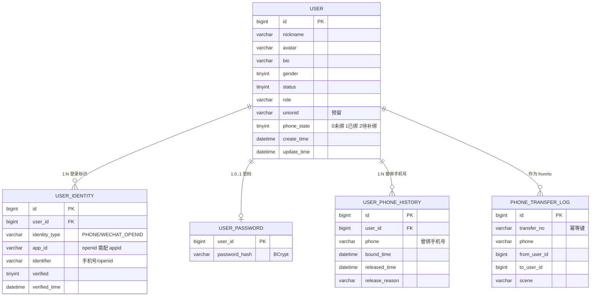
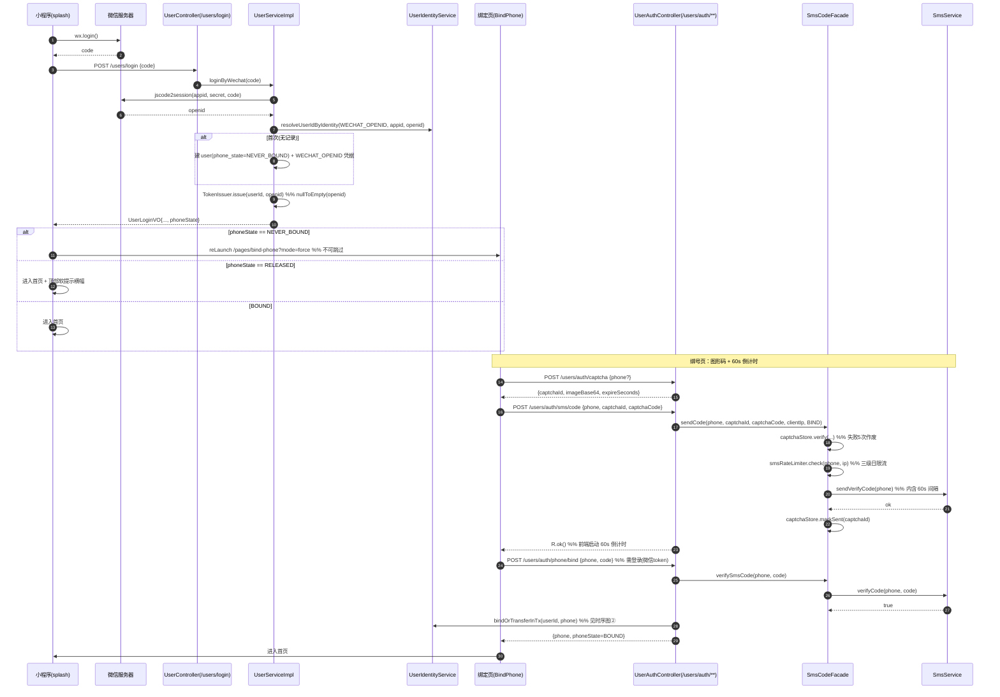
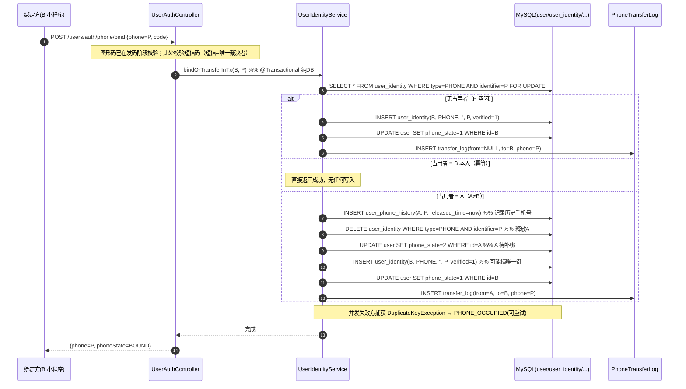
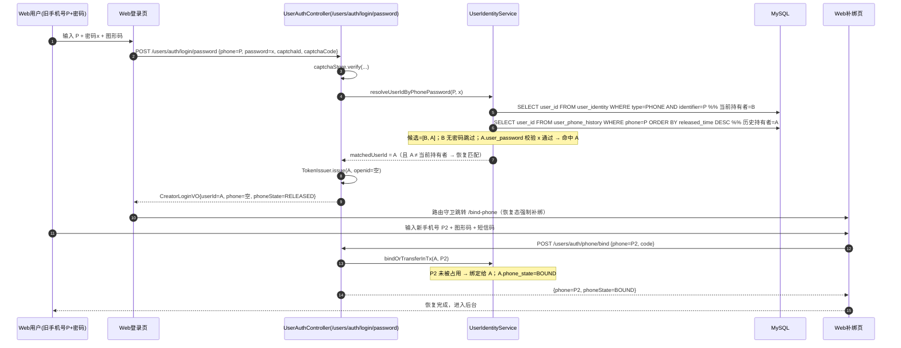
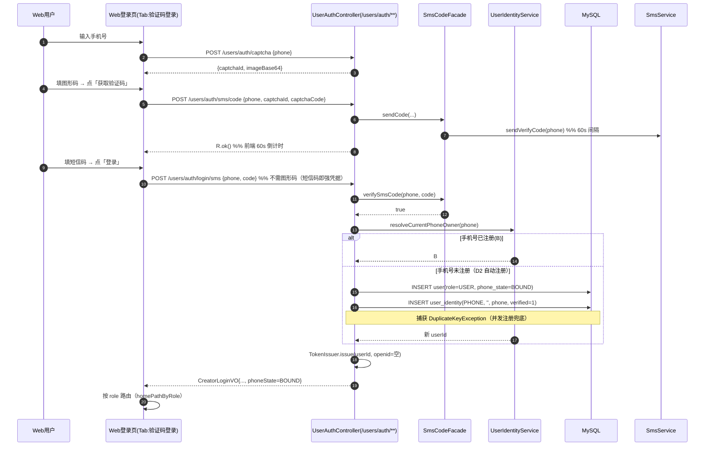
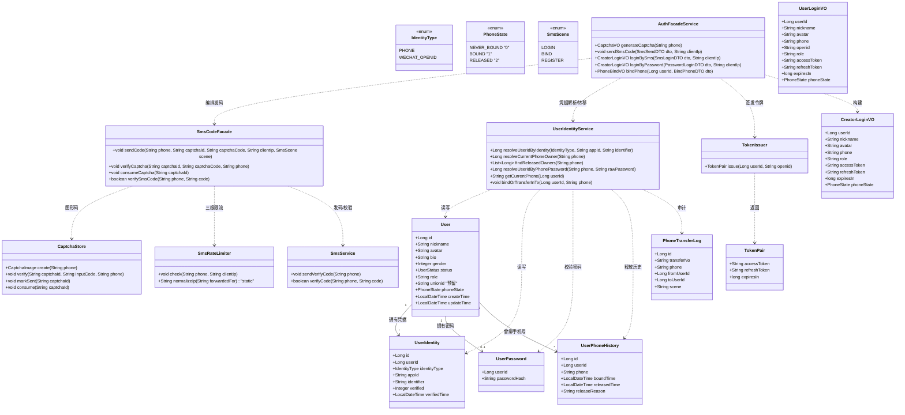
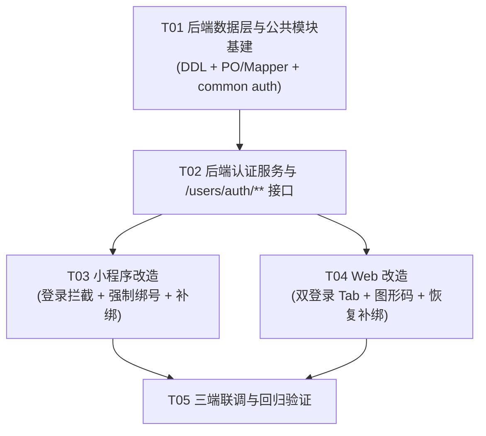

# TryBe 统一账号体系 v2 · 架构设计与任务分解

> 文档类型：架构设计 + 任务分解（Architecture & Task Breakdown）
> 作者：高见远（Gao）· 架构师
> 面向版本：TryBe Auth v2
> 上游输入：`docs/auth-v2/01-PRD.md`（增量 PRD）、`docs/统一账号体系设计.md`（根因分析）
> 落地约束：需求 #5（抽离 openid/phone/密码）、D1~D6（已锁定决策）、PRD §6 冲突决策表、E1~E9 边界
> 交付形态：**只交付、不代执行**；SQL 脚本可直接在 Navicat / DataGrip 运行

---

## 0. 阅读指引（给主理人与工程师）

本文档同时承担两个职责：

- **Part A 系统设计**：数据模型、类图、时序图、接口契约、文件清单
- **Part B 任务分解**：依赖包、有序任务列表、共享知识、依赖图

**三处必须特别关注（本次架构的核心考验）：**

| # | 风险点 | 定位 |
|---|---|---|
| R1 | **账号恢复路径**（无 openid 的 A 被清空手机号后如何登录、如何与 B 隔离） | §A.4、§A.4.1、时序图③ |
| R2 | **并发兜底**（同号两候选账号的匹配优先级 + `DuplicateKeyException`） | §A.3.3、§A.4.2 |
| R3 | **`/users/auth/**` 免鉴权白名单**（Nacos 网关 + `MvcConfig` 双处同步） | §A.6、§A.9 |

---

# Part A：系统设计

## A.1 实现方案总览与关键技术选型

### A.1.1 核心矛盾与破题思路

本次需求本质是一条**「凭据与主体分离」+「手机号唯一锚点 + 确定性冲突归属」**的改造：

```
现状（撞车根源）：一张 user 表混装「人」+「手机号凭据」+「微信凭据」+「密码」
    → 两个登录入口各自 find-or-create → 必然撞车（PRD P1/P3/P4）

目标：User(人)  1:N  Identity(登录标识)
    user         只放「人」的属性
    user_identity 只放「登录标识」（手机号 / openid），唯一约束兜底
    user_password 只放「密码」（与手机号解耦，手机号易主后仍随人走）
    user_phone_history 记录「曾绑定但已释放」的手机号 → 支撑恢复路径
```

**关键判断（本次架构的取舍）：**

| 议题 | 决策 | 理由 |
|---|---|---|
| 手机号存哪 | **`user_identity`（PHONE 类型）** | 忠实需求 #5「phone 从 user 抽离」；唯一性由 `uk_type_app_identifier` 兜底（详见 §A.3.2 与 `uk_phone` 等价性说明） |
| openid 存哪 | **`user_identity`（WECHAT_OPENID 类型，带 app_id）** | openid 是「用户 × appid」维度，必须带 app_id（企业实践） |
| 密码存哪 | **独立表 `user_password`（1:1 user）** | ① 密码是「人」的凭据，应随人走——手机号易主后 A 的密码无需迁移/拷贝；② 避免把密码哈希写进 `user_phone_history` 这类审计表；③ 与参考设计「凭据与主体分离」一致 |
| 冲突归属（D3） | **短信验证码为唯一裁决者**；同号两候选账号靠「凭据类型 + 匹配优先级」无歧义区分 | 见 §A.4 |
| 恢复路径 | **保留 A 的密码 + 记录历史手机号；密码登录时按「当前持有者 → 历史持有者」顺序匹配** | 破解 PRD 未覆盖的死锁（无 openid 的 A 被清号后永久锁死） |

### A.1.2 技术选型

| 关注点 | 选型 | 理由 |
|---|---|---|
| 图形验证码 | **复用既有 `CaptchaStore`**（Hutool `ShearCaptcha` + Redis，答案只在服务端，失败 5 次作废，TTL 300s） | PRD P10 已验证可用；答案只在服务端是它有效的前提 |
| 短信发送 | **复用既有 `SmsService`**（`TryBe-common`，内含 60s 间隔 `sms:limit:{phone}`） | 需求 #7「尽量复用」；60s 间隔已有实现 |
| 三级日限流 | **复用既有 `SmsRateLimiter`**（手机号 10/天、IP 30/天、全局 200/天） | PRD E2；免鉴权发码接口的第二道防线 |
| 编排抽象 | **新增公共组件 `SmsCodeFacade`**（图形码→限流→发码→markSent，`com.trybe.common.auth`） | 消除 `CreatorAuthServiceImpl` 与新 `/users/auth/**` 的重复编排；只编排 common 内组件，无反向依赖 |
| 令牌下发 | **新增 `TokenIssuer`（`com.trybe.user.support`，user-service 本地）** | 集中修复 P5（`nullToEmpty(openid)`），杜绝各 Service 重复实现 `saveToken`。**不放 common**：它依赖 user-service 的 `JwtTool`/`RefreshTokenUtil`/`JwtProperties`，放 common 会形成 common→user-service 反向依赖 + 编译失败 |
| 并发兜底 | **DB 唯一索引 + 捕获 `DuplicateKeyException`** | 代码校验挡不住并发，只有唯一索引能（企业实践 #1） |
| 事务边界 | **含外部交互（短信/OSS）的编排方法不加 `@Transactional`；纯 DB 的归属转移抽成独立 `@Transactional` 方法** | 既有硬约定；避免长事务占连接 |
| 数据访问 | **MyBatis-Plus 3.4.2 + LambdaQueryWrapper** | 与现有代码一致 |

### A.1.3 架构分层

```
Controller 层   UserAuthController(/users/auth/**)  ← 新增
                CreatorAuthController(/users/creator/auth/**) ← 保留兼容
                PhoneController / PasswordController / UserController ← 保留
      │  统一 UserContext.requireUser()、统一 R<T>
Service 层      AuthFacadeService（新，编排：图形码/限流/发码/登录/绑定）
                UserIdentityService（新，凭据解析 + 匹配优先级 + 归属转移事务）
                UserServiceImpl / PhoneServiceImpl / PasswordServiceImpl / CreatorAuthServiceImpl（改造）
      │
Support/Common  TokenIssuer（新，`com.trybe.user.support`，user-service 本地：依赖本地 Jwt 三件套）
                SmsCodeFacade（新，common）· CaptchaStore / SmsRateLimiter（迁入 common）
                SmsService / OssService / UserContext / R / ErrorCodeEnum（common）
                JwtTool / RefreshTokenUtil / JwtProperties（**user-service 本地，不动**）
      │
DAO 层          UserMapper + UserIdentityMapper / UserPasswordMapper / UserPhoneHistoryMapper / PhoneTransferLogMapper
```

---

## A.2 数据库设计

### A.2.1 目标模型（ER 关系）



### A.2.2 完整 DDL（增量改造脚本，可直接执行）

> 文件：`sql/userService/统一账号体系v2改造.sql`（新增）
> **必须带 `USE trybe;`；禁止使用 `DELIMITER`；只交付不代执行。**

```sql
-- =============================================================
-- TryBe 统一账号体系 v2 改造脚本
--   内容：user 表重构（抽离 openid/phone/password）
--         + user_identity 凭据表 + user_password 密码表
--         + user_phone_history 曾绑手机号表 + phone_transfer_log 审计/幂等表
-- 目标库：trybe（虚拟机 192.168.100.128）
-- 说明：只交付不代执行；已带 USE trybe;；未使用 DELIMITER；可直接 Navicat/DataGrip 运行
-- 执行顺序：Part 0 → Part 7 严格按序；Part 6（DROP 旧列）务必在**新代码上线并验证通过后**再执行
-- 幂等：Part 2 建表、Part 3 迁移（INSERT IGNORE）、Part 4 回填 可重复执行
-- =============================================================

USE trybe;

-- -------------------------------------------------------------
-- Part 0  前置体检（全为 0 行才能继续）
-- -------------------------------------------------------------

-- 0.1 重复手机号（>0 行会导致迁移后唯一约束失效，必须先人工处置）
SELECT phone, COUNT(*) AS cnt, GROUP_CONCAT(id) AS user_ids
FROM `user`
WHERE phone IS NOT NULL AND phone <> ''
GROUP BY phone
HAVING cnt > 1;

-- 0.2 一个手机号被多个账号占用（含空串视为未绑定）
SELECT phone, COUNT(*) AS cnt FROM `user`
WHERE phone IS NOT NULL AND phone <> ''
GROUP BY phone HAVING cnt > 1;

-- -------------------------------------------------------------
-- Part 1  user 表重构：新增字段（不删旧列，先加后移）
-- -------------------------------------------------------------

-- 1.1 新增手机号归属状态（PRD Q4 机制）
--     0 = NEVER_BOUND 从未绑定过手机号（小程序首登 → 硬拦截强制绑号）
--     1 = BOUND       当前已绑定手机号
--     2 = RELEASED    曾绑定过、已被释放（小程序软提示补绑，不拦截）
ALTER TABLE `user`
    ADD COLUMN `phone_state` TINYINT NOT NULL DEFAULT 0
        COMMENT '手机号归属状态：0从未绑定 1已绑定 2曾绑定被释放(待补绑)' AFTER `role`;

-- 1.2 unionid 预留（个人主体拿不到，注册开放平台后可启用）
ALTER TABLE `user`
    ADD COLUMN `unionid` VARCHAR(64) DEFAULT NULL
        COMMENT '微信开放平台 unionid（预留，不启用）' AFTER `role`;

-- unionid 唯一（亦然：MySQL 唯一索引允许多个 NULL，未绑定账号不受影响）
ALTER TABLE `user` ADD UNIQUE KEY `uk_unionid` (`unionid`);

-- -------------------------------------------------------------
-- Part 2  新增凭据表 / 密码表 / 历史表 / 审计表
-- -------------------------------------------------------------

-- 2.1 登录凭据表（User 1 : N Identity）
CREATE TABLE IF NOT EXISTS `user_identity` (
    `id`            BIGINT       NOT NULL AUTO_INCREMENT COMMENT '凭据ID',
    `user_id`       BIGINT       NOT NULL                COMMENT '所属用户ID（指向 user.id）',
    `identity_type` VARCHAR(24)  NOT NULL                COMMENT '凭据类型：PHONE / WECHAT_OPENID',
    `app_id`        VARCHAR(64)  NOT NULL DEFAULT ''     COMMENT '应用标识：openid 必须配小程序 appid；手机号填空串',
    `identifier`    VARCHAR(128) NOT NULL                COMMENT '凭据值：手机号 / openid',
    `verified`      TINYINT      NOT NULL DEFAULT 0      COMMENT '是否已验证：0否 1是（手机号需过短信验证）',
    `verified_time` DATETIME     DEFAULT NULL            COMMENT '验证通过时间',
    `create_time`   DATETIME     NOT NULL DEFAULT CURRENT_TIMESTAMP COMMENT '创建时间',
    `update_time`   DATETIME     NOT NULL DEFAULT CURRENT_TIMESTAMP ON UPDATE CURRENT_TIMESTAMP COMMENT '更新时间',
    PRIMARY KEY (`id`),
    UNIQUE KEY `uk_type_app_identifier` (`identity_type`, `app_id`, `identifier`),
    KEY `idx_user` (`user_id`),
    KEY `idx_identifier` (`identifier`)
) ENGINE=InnoDB DEFAULT CHARSET=utf8mb4 COLLATE=utf8mb4_general_ci
  COMMENT='用户登录凭据表（一个用户 N 条凭据；手机号唯一性由 uk_type_app_identifier 承担）';

-- 2.2 密码表（与手机号解耦：手机号易主后密码仍随「人」走，支撑恢复路径）
CREATE TABLE IF NOT EXISTS `user_password` (
    `user_id`       BIGINT       NOT NULL COMMENT '用户ID（1:1 user.id）',
    `password_hash` VARCHAR(128) NOT NULL COMMENT '密码 BCrypt 哈希',
    `create_time`   DATETIME     NOT NULL DEFAULT CURRENT_TIMESTAMP COMMENT '创建时间',
    `update_time`   DATETIME     NOT NULL DEFAULT CURRENT_TIMESTAMP ON UPDATE CURRENT_TIMESTAMP COMMENT '更新时间',
    PRIMARY KEY (`user_id`)
) ENGINE=InnoDB DEFAULT CHARSET=utf8mb4 COLLATE=utf8mb4_general_ci
  COMMENT='用户密码表（与 user_identity 分离，手机号流转不影响密码归属）';

-- 2.3 曾绑手机号历史表（手机号被释放时写入，供恢复路径匹配）
CREATE TABLE IF NOT EXISTS `user_phone_history` (
    `id`             BIGINT      NOT NULL AUTO_INCREMENT COMMENT '主键',
    `user_id`        BIGINT      NOT NULL                COMMENT '曾绑定该号的账号（即被释放的 A）',
    `phone`          VARCHAR(20) NOT NULL                COMMENT '曾绑定的手机号',
    `bound_time`     DATETIME    DEFAULT NULL            COMMENT '上次绑定该号的时间',
    `released_time`  DATETIME    NOT NULL DEFAULT CURRENT_TIMESTAMP COMMENT '释放时间',
    `release_reason` VARCHAR(32) NOT NULL DEFAULT 'PHONE_TRANSFERRED' COMMENT '释放原因：PHONE_TRANSFERRED 被其他账号抢绑',
    PRIMARY KEY (`id`),
    KEY `idx_phone` (`phone`),
    KEY `idx_user` (`user_id`)
) ENGINE=InnoDB DEFAULT CHARSET=utf8mb4 COLLATE=utf8mb4_general_ci
  COMMENT='曾绑定但已释放的手机号（恢复路径 + 审计）';

-- 2.4 手机号归属转移日志（幂等键 + 审计）
CREATE TABLE IF NOT EXISTS `phone_transfer_log` (
    `id`           BIGINT      NOT NULL AUTO_INCREMENT COMMENT '主键',
    `transfer_no`  VARCHAR(64) NOT NULL                COMMENT '幂等键（服务端按 B+phone+时间窗生成）',
    `phone`        VARCHAR(20) NOT NULL                COMMENT '被转移的手机号',
    `from_user_id` BIGINT      DEFAULT NULL            COMMENT '被释放方 A（无占用者时为 NULL）',
    `to_user_id`   BIGINT      NOT NULL                COMMENT '获得方 B',
    `scene`        VARCHAR(32) NOT NULL                COMMENT '触发场景：BIND_PHONE',
    `create_time`  DATETIME    NOT NULL DEFAULT CURRENT_TIMESTAMP COMMENT '转移时间',
    PRIMARY KEY (`id`),
    UNIQUE KEY `uk_transfer_no` (`transfer_no`),
    KEY `idx_phone` (`phone`)
) ENGINE=InnoDB DEFAULT CHARSET=utf8mb4 COLLATE=utf8mb4_general_ci
  COMMENT='手机号归属转移日志（uk_transfer_no 保证同一请求不重复执行）';

-- -------------------------------------------------------------
-- Part 3  存量数据迁移（user 旧列 → 新表；INSERT IGNORE 可重复执行）
-- -------------------------------------------------------------

-- 3.1 手机号凭据
INSERT IGNORE INTO `user_identity`
    (`user_id`, `identity_type`, `app_id`, `identifier`, `verified`, `verified_time`)
SELECT `id`, 'PHONE', '', `phone`, 1, `create_time`
FROM `user`
WHERE `phone` IS NOT NULL AND `phone` <> '';

-- 3.2 微信 openid 凭据
--     ⚠️ 执行前把 '<小程序appid>' 替换为实际 appid（如 wx1234567890abcdef）！
INSERT IGNORE INTO `user_identity`
    (`user_id`, `identity_type`, `app_id`, `identifier`, `verified`, `verified_time`)
SELECT `id`, 'WECHAT_OPENID', '<小程序appid>', `openid`, 1, `create_time`
FROM `user`
WHERE `openid` IS NOT NULL AND `openid` <> '';

-- 3.3 密码
INSERT IGNORE INTO `user_password` (`user_id`, `password_hash`, `create_time`)
SELECT `id`, `password`, `create_time`
FROM `user`
WHERE `password` IS NOT NULL AND `password` <> '';

-- 3.4 迁移核对（数量级应与源列一致）
SELECT 'PHONE' AS t, COUNT(*) AS migrated FROM `user_identity` WHERE identity_type = 'PHONE'
UNION ALL SELECT 'WECHAT_OPENID', COUNT(*) FROM `user_identity` WHERE identity_type = 'WECHAT_OPENID'
UNION ALL SELECT 'PASSWORD', COUNT(*) FROM `user_password`
UNION ALL SELECT 'user.phone_not_null', COUNT(*) FROM `user` WHERE phone IS NOT NULL AND phone <> ''
UNION ALL SELECT 'user.openid_not_null', COUNT(*) FROM `user` WHERE openid IS NOT NULL AND openid <> '';

-- -------------------------------------------------------------
-- Part 4  回填手机号归属状态
--   有手机号 → BOUND(1)；无手机号 → NEVER_BOUND(0)
--   （RELEASED(2) 只会在 Part 5 之后的运行时转移中产生，存量不会出现）
-- -------------------------------------------------------------

UPDATE `user`
SET `phone_state` = CASE
    WHEN `phone` IS NOT NULL AND `phone` <> '' THEN 1
    ELSE 0
END;

-- -------------------------------------------------------------
-- Part 5  唯一约束与索引核查
--   手机号唯一性由 user_identity.uk_type_app_identifier 承担（见 §A.3.2，主理人已裁决：phone 不在 user 表保留）
-- -------------------------------------------------------------

-- 5.1 核查：是否仍存在「一个手机号挂多个账号」（应为 0 行）
SELECT i.identifier AS phone, COUNT(DISTINCT i.user_id) AS user_cnt, GROUP_CONCAT(i.user_id) AS user_ids
FROM `user_identity` i
WHERE i.identity_type = 'PHONE'
GROUP BY i.identifier
HAVING user_cnt > 1;

-- -------------------------------------------------------------
-- Part 6  清理旧列（⚠️ 必须在**新代码上线并验证通过后**再执行！）
--   跨模块影响已检索完毕（见 §B.10-⑥）：
--     · 非 user-service 模块无 mapper XML；仅 creator-service/UserReadMapper 读 user 表，
--       且只查 role/nickname/id/count，不碰凭据列 → DROP 对其它模块无代码影响。
--     · 唯一漏网点：sql/userService/初始化运营管理员账号.sql 读了 user.phone → 须先改走 user_identity。
-- -------------------------------------------------------------

ALTER TABLE `user` DROP INDEX `uk_openid`;      -- 若不存在会报错，可忽略
ALTER TABLE `user` DROP INDEX `idx_phone`;      -- 若不存在会报错，可忽略
ALTER TABLE `user` DROP COLUMN `openid`;
ALTER TABLE `user` DROP COLUMN `phone`;
ALTER TABLE `user` DROP COLUMN `password`;

-- -------------------------------------------------------------
-- Part 7  上线后核查
-- -------------------------------------------------------------

-- 7.1 凭据类型分布
SELECT identity_type, COUNT(*) AS cnt FROM `user_identity` GROUP BY identity_type;

-- 7.2 待补绑账号（phone_state=2）
SELECT u.id, u.nickname, u.role, u.phone_state, u.update_time
FROM `user` u WHERE u.phone_state = 2 ORDER BY u.update_time DESC;

-- 7.3 从未绑定手机号的小程序账号（将触发硬拦截）
SELECT u.id, u.nickname, u.phone_state, i.identifier AS openid
FROM `user` u JOIN `user_identity` i ON i.user_id = u.id AND i.identity_type = 'WECHAT_OPENID'
WHERE u.phone_state = 0;

-- 7.4 手机号转移日志
SELECT * FROM `phone_transfer_log` ORDER BY `id` DESC LIMIT 50;
```

### A.2.3 数据一致性说明

| 关注点 | 说明 |
|---|---|
| **手机号唯一** | 由 `user_identity.uk_type_app_identifier(PHONE,'',手机号)` 承担；`identifier` 不允许同 `(type,app_id)` 下重复 |
| **未绑号账号** | 不写 PHONE 凭据行 → 天然无唯一冲突（等价于「多 NULL 友好」，见 §A.3.2） |
| **密码与手机号解耦** | 密码存 `user_password`（按 `user_id`），手机号转移只动 `user_identity`，密码**永不随手机号迁移**（落实 D6） |
| **phone_state 与凭据的对应** | `phone_state` 是派生/加速字段：有 PHONE 凭据行 ↔ 期望 `BOUND`；无 PHONE 行且 `phone_state=2` ↔ 曾绑被释放。以**事务内同写**保证一致 |
| **历史表只增不改** | `user_phone_history` 为 append-only 审计 + 恢复依据，不参与唯一约束 |
| **可重复执行** | 建表 `IF NOT EXISTS`、迁移 `INSERT IGNORE`；Part 1/Part 6 的 `ADD/DROP` 重复执行会报错，报错可忽略 |

---

## A.3 关键机制设计

### A.3.1 凭据身份（IdentityType）与登录语义

```
登录语义从「按手机号找人」改为「按凭据找人」：
  PHONE           → user_identity(PHONE, '', 手机号)
  WECHAT_OPENID   → user_identity(WECHAT_OPENID, appid, openid)
```

- `app_id` 对手机号恒为空串（`NOT NULL DEFAULT ''`），保证手机号唯一键退化为 `(PHONE,'',手机号)`。
- 对 openid 必须带 appid，避免未来第二个小程序 openid 撞车（企业实践）。

### A.3.2 手机号唯一约束与并发兜底（含 `uk_phone` 说明）

**唯一方案（主理人已裁决，不做备选）：手机号唯一性 = `user_identity.uk_type_app_identifier`。**

- 给手机号加唯一约束的载体是 `user_identity` 的复合唯一键 `(identity_type, app_id, identifier)`；对 PHONE 类型而言，它**等价于 `uk_phone(identifier)`**。
- **为何对「未绑号账号」友好**：未绑号账号根本没有 PHONE 凭据行 → 不产生任何唯一冲突；比「靠 MySQL 唯一索引允许多个 NULL」更彻底（后者依赖列语义，前者根本不写行）。
- `user` 表**不再保留 `phone` 列**，避免与 `user_identity` 双写漂移（落实需求 #5「phone 从 user 表抽离」）。
- 迁移脚本 Part 5 的核查查询即为该约束的验收 SQL。

**并发兜底（代码层）：**

```java
// 伪码：归属转移事务内
try {
    userIdentityMapper.insert(new UserIdentity()...identifier(phone)...); // 或 updateById 抢占
} catch (DuplicateKeyException e) {
    // 另一个并发事务先抢到了该手机号 → 幂等收敛或返回可重试提示
    throw new BizIllegalException(ErrorCodeEnum.PHONE_OCCUPIED, "操作冲突，请稍后重试");
}
```

### A.3.3 「同号两候选账号」的匹配优先级（无歧义、可测试）

同一手机号 P 上可能同时存在两个候选账号：**当前持有者 B**（`user_identity(PHONE,P)`）与**历史持有者 A**（`user_phone_history` 中 `phone=P`）。匹配规则按**凭据类型**严格分流：

| 登录方式 | 裁决凭据 | 候选集合（有序） | 选中规则 |
|---|---|---|---|
| **短信验证码登录 / 归属转移** | **短信验证码**（证明持有 SIM = 当前持有者） | 仅 `user_identity(PHONE,P).user_id`（即 B） | **永远命中 B**，绝不命中历史持有者 A |
| **密码登录** | **密码**（证明持有账号机密） | ① 当前持有者 B；② 历史持有者 A（按 `released_time DESC` 去重） | 按序返回**第一个 `user_password` 校验通过**的账号 |

密码登录判定为「恢复匹配」的充要条件：**选中的账号 ≠ 当前持有者**。此时返回结果携带 `phoneState=RELEASED`，前端强制/引导补绑。

**为什么无歧义、可测试：**

- 短信路径候选唯一 → 恒等于 B，断言简单。
- 密码路径候选有序（当前优先、历史按时间倒序）且「谁的密码对就是谁」→ 密码是唯一机密，正常情况下只有一个候选匹配。
- 极端并列（B 与 A 设了**完全相同**的密码）：由「当前持有者优先」确定性收敛到 B，仍无歧义。

**测试用例（验收）：**

| 用例 | 前置 | 输入 | 期望 |
|---|---|---|---|
| C1 | P 归 B，B 有密码 | P + B密码 | 登录 B，`phoneState=BOUND` |
| C2 | P 归 B（B 无密码），A 被释放且有密码 | P + A密码 | 登录 **A**（恢复），`phoneState=RELEASED` |
| C3 | P 归 B（B 有密码），A 被释放且有密码 | P + A密码 | 登录 **A**（恢复），不进入 B |
| C4 | P 归 B，A 被释放（无密码行） | P + 任意 | 「手机号或密码错误」，不登录任何账号 |
| C5 | P 归 B | 短信登录 P 的验证码 | 命中 B（短信路径恒 B） |

---

## A.4 账号恢复路径设计（解决 PRD 未覆盖的死锁）★核心

### A.4.1 死锁与破题

**死锁**（主理人复核发现）：D3 规则下，手机号 P 被当前账号 B 抢绑后，原持有者 A 的手机号被清空。

- A 有 openid（微信账号）→ 可用微信登录 → 软提示补绑。**无问题**。
- A 无 openid（**Web 手机号注册账号**）→ 既不能手机号登录（号没了），也没微信 → **永久锁死**。

**有利性质（数据上成立）**：`A 无 openid ⟹ A 是 Web 注册账号 ⟹ A 必然设置过密码`（`CreatorRegisterDTO` 强制密码）。

**破题**：**「历史手机号 + 密码」作为 A 的恢复凭据。**

- 保留 A 的密码（`user_password[A]`，随人走，不迁移给 B）；
- 记录 A 曾绑定的手机号（`user_phone_history`）；
- 密码登录时：先按「当前有效 PHONE 凭据」匹配（命中 B 的密码登录），匹配不到再按「历史手机号 + 密码」恢复匹配（命中 A）；
- 恢复登录成功后，前端**引导/强制补绑新手机号**，A 恢复正常态。

### A.4.2 隔离保证（A 的恢复不泄露 B，B 的登录不进入 A）

| 保证 | 机制 |
|---|---|
| **B 的短信登录 / 归属转移永不进入 A** | 短信路径候选集合**只有当前持有者**（§A.3.3），历史持有者不参与短信裁决 |
| **A 的密码恢复永不进入 B** | 密码路径「谁密码对命中谁」；B 通常无密码（微信建号不设密码），即便 B 设了密码也与 A 的密码不同 → A 命中 A |
| **数据不串** | 两者返回不同 `user_id`；衣柜/身形/素材全挂 `user_id`，天然隔离 |
| **A 的旧密码不为 B 所用** | 密码存 `user_password[A]`，B 的 `user_password[B]` 独立；D6「旧密码不迁移给 B」达成 |
| **可测试** | 见 §A.3.3 测试用例 C2/C3/C5 |

> **对 PRD Q3「A 的旧密码立即失效」的口径澄清**：本设计中 A 的旧密码**不再作为「手机号 P 的登录密码」**（无法登录当前持有 P 的 B），也**不写入 B**；但作为 **A 账号自身的恢复凭据**保留。这是对 Q3 措辞的必要放宽——若彻底作废，无 openid 的 A 将永久锁死，与用户「A 登录时提示补绑」的预期直接冲突。见 Part B 待明确 §B.10-③。

### A.4.3 恢复路径与「小程序首登强制绑号」互不冲突

| 账号类型 | `phone_state` | 小程序行为 | 说明 |
|---|---|---|---|
| 新微信账号（从未绑号） | `NEVER_BOUND(0)` | **硬拦截**：微信登录后强制跳绑定页，无跳过 | 落实需求 #1 |
| 曾绑被释放的 A（有 openid） | `RELEASED(2)` | **软提示**：微信登录后正常进入，顶部横幅引导补绑 | 落实 US2，不锁死 |
| 正常账号 B | `BOUND(1)` | 正常 | — |

判定落到 `user.phone_state` 一个字段，登录 VO 回传 `phoneState`，小程序据此区分「硬拦截 vs 软提示」，**二者互斥、可测**。

### A.4.4 恢复路径完整时序（见 §A.5 时序图③）

```
Web 用户输入 [旧手机号 P] + [密码 x] + 图形码
  → /users/auth/login/password
     → 校验图形码
     → resolveUserIdByPhonePassword(P, x)：
        候选 = [当前持有者 B] + [历史持有者 A(按 released_time desc)]
        B 无密码 → 跳过；A.user_password 校验 x 通过 → 命中 A（恢复匹配）
     → 签发 A 的令牌，VO.phoneState = RELEASED
  → Web 前端：进入「补绑手机号」引导（受保护路由守卫）
     → 输入 [新手机号 P2] + 短信码（前置图形码）→ /users/auth/phone/bind
     → P2 未被占用 → 绑定成功，A.phone_state = BOUND → 恢复完成
```

---

## A.5 时序图（Mermaid sequenceDiagram）

### ① 小程序微信登录 + 强制绑号（含 60s / 图形码）



### ② 手机号被占用时的归属转移（D3）



### ③ A 的账号恢复路径（无 openid 的 Web 账号）



### ④ Web 短信验证码登录（未注册自动注册，D2）



---

## A.6 类图



---

## A.7 `/users/auth/**` 接口契约表

> 全局约定：统一返回 `R<T>`（`{code,msg,data}`），**HTTP 一律 200**，靠 `code` 区分。

### A.7.1 新增端点

| # | 方法 | 路径 | 鉴权 | 请求体 | 响应 data | 主要错误码 |
|---|---|---|---|---|---|---|
| A1 | POST | `/users/auth/captcha` | **免** | `{phone?}` | `CaptchaVO{captchaId,imageBase64,expireSeconds}` | — |
| A2 | POST | `/users/auth/sms/code` | **免** | `{phone,captchaId,captchaCode,scene?}` | `Void` | `105` 图形码错误 · `406` 60s/日限流 · `400` |
| A3 | POST | `/users/auth/login/sms` | **免** | `{phone,code}` | `CreatorLoginVO` | `400` 短信码错误 · `300` |
| A4 | POST | `/users/auth/login/password` | **免** | `{phone,password,captchaId,captchaCode}` | `CreatorLoginVO`（含 `phoneState`） | `105` · `300` 手机号或密码错误 · `304` 冻结 |
| A5 | POST | `/users/auth/phone/bind` | **需登录** | `{phone,code}` | `PhoneBindVO{userId,phone,phoneState}` | `400` · `405` 并发冲突可重试 |
| A6 | GET | `/users/auth/phone` | **需登录** | — | `PhoneBindVO{userId,phone,phoneState}` | — |

**请求/响应字段（按端到端可落地）**

```jsonc
// UserAuthController 涉及的关键 DTO / VO
SmsSendDTO      { "phone": "138...", "captchaId": "uuid", "captchaCode": "8k2f", "scene": "BIND" }
SmsLoginDTO     { "phone": "138...", "code": "123456" }          // 不需图形码（短信码为强凭据）
PasswordLoginDTO{ "phone": "138...", "password": "xxxx", "captchaId": "uuid", "captchaCode": "8k2f" }
BindPhoneDTO    { "phone": "138...", "code": "123456" }

CreatorLoginVO  { userId, nickname, avatar, phone, role, accessToken, refreshToken, expiresIn, phoneState }
PhoneBindVO     { userId, phone, phoneState }
CaptchaVO       { captchaId, imageBase64, expireSeconds }
```

**各端点业务语义**

| 端点 | 语义要点 |
|---|---|
| A1 captcha | 复用 `CaptchaStore.create`；`phone` 选填（传入则验证码与手机号绑定）。`expireSeconds=300` |
| A2 sms/code | `SmsCodeFacade.sendCode`：**图形码校验 → 三级限流 → 发码（内含 60s 间隔）→ markSent**。不加 `@Transactional`（含外部短信交互） |
| A3 login/sms | **不需图形码**（短信码即强凭据；发码侧已有图形码+限流+60s 三重防护）→ 短信码校验 → `resolveCurrentPhoneOwner`：**命中则登录当前持有者；未命中则 D2 自动注册**（建 user + PHONE 凭据，捕获 `DuplicateKeyException`）→ 发令牌 |
| A4 login/password | 图形码校验 → `resolveUserIdByPhonePassword`（§A.3.3 优先级）→ 命中则登录；**命中≠当前持有者 → 恢复匹配**（VO.phoneState=RELEASED 供前端引导补绑）→ 统一文案「手机号或密码错误」防枚举 |
| A5 phone/bind | 需登录（`UserContext.requireUser()`）→ 短信码校验 → `bindOrTransferInTx`（D3，纯 DB 事务）→ 返回新 `phoneState` |
| A6 phone | 查询当前手机号与状态（Web 恢复态刷新用） |

### A.7.2 鉴权与白名单（★R3）

| 端点 | 网关白名单（Nacos `hm.auth.excludePaths`） | `MvcConfig.excludePathPatterns` |
|---|---|---|
| `/users/auth/captcha` | ✅ 加入 | ✅ 加入 |
| `/users/auth/sms/code` | ✅ 加入 | ✅ 加入 |
| `/users/auth/login/sms` | ✅ 加入 | ✅ 加入 |
| `/users/auth/login/password` | ✅ 加入 | ✅ 加入 |
| `/users/auth/phone/bind` | ❌ **必须登录**，不得加入 | ❌ 不加入 |
| `/users/auth/phone` | ❌ 不加入 | ❌ 不加入 |

> **网关白名单配置在 Nacos，不在代码里** → 必须由用户去 Nacos 显式添加上述 4 条（仅路径，非通配 `/users/auth/**`，因为 `phone/bind` 需鉴权）。

### A.7.3 兼容端点（保留，不删）

`/users/creator/auth/{register,login,captcha,send-code,upgrade}`、`/users/phone/{login,send-code,bind}`、`/users/login`（微信）、`/auth/{refresh-token,logout}` 全部**保留可用**。

### A.7.4 新增错误码（`ErrorCodeEnum`，需同步 Web + 小程序）

| 枚举 | code | msg | 用途 |
|---|---|---|---|
| `CAPTCHA_ERROR` | 105 | 图形验证码错误或已失效 | 前端据此**自动刷新图形码** |
| `PHONE_OCCUPIED` | 405 | 该手机号已被占用 | 并发冲突兜底（可重试） |
| `SMS_TOO_FREQUENT` | 406 | 短信验证码发送过于频繁，请稍后再试 | 60s 间隔未到（配合 `msg` 剩余秒数） |
| `NEED_BIND_PHONE` | 407 | 请先绑定手机号后再操作 | 未绑号账号调用受保护接口的服务端兜底 |

> 同步点：`D:\WeChatProjects\Trybe\utils\constants.js` 的 `BIZ_CODE`、`D:\trybeHtml\src\constants\bizCode.ts`。

---

## A.8 公共模块提取方案（★S8）

### A.8.1 取舍结论

| 组件 | 现状 | 决策 | 理由 |
|---|---|---|---|
| `CaptchaStore` | `user-service/util` | **上移至 `TryBe-common`（`com.trybe.common.auth`）** | 通用基础设施（Hutool + Redis），被新 auth 流与 creator 流共用；common 已含 `hutool-all` 与 `spring-boot-starter-data-redis(provided)`，迁移零新增依赖；`UserApplication` 已 `scanBasePackages=com.trybe.common`，Bean 可被扫描 |
| `SmsRateLimiter` | `user-service/util` | **上移至 `TryBe-common`（`com.trybe.common.auth`）** | 同上；免鉴权发码的通用防线 |
| 发码编排 | 散落在 `CreatorAuthServiceImpl.sendRegisterCode` | **抽取 `SmsCodeFacade`（新，common）** | 消除「图形码→限流→发码→markSent」重复编排；单一实现、单一修复点；仅编排 common 内组件，无反向依赖 |
| 令牌下发 | `buildLoginVO` 在多个 Service 重复 | **抽取 `TokenIssuer`（新，`com.trybe.user.support`，user-service 本地）** | 集中 `nullToEmpty(openid)`（修 P5），杜绝遗漏。**不可放 common**：依赖 user-service 的 `JwtTool`/`RefreshTokenUtil`/`JwtProperties`，放 common 会反向依赖 + 编译失败 |
| `SmsService` | 已在 common | **就地复用** | 已是公共实现，无需迁移 |

**为什么「上移 common」而非「就地复用」**：新 `/users/auth/**` 与既有 `/users/creator/auth/**` 都要用同一套图形码/限流/发码，若留在 `user-service` 就无法在 common 里做 `SmsCodeFacade` 统一编排（否则 common 依赖 user-service，形成反向依赖）。上移后：`user-service` 与未来任意模块均可复用。

**迁 common 的反向依赖核验（已确认无 §A.11 需求依赖 user-service）**：

| 组件（common） | 依赖来源 | 结论 |
|---|---|---|
| `CaptchaStore` | `cn.hutool.captcha`（common 有 hutool-all）、`StringRedisTemplate`（redis provided）、common 的 `ErrorCodeEnum`/`BizIllegalException` | ✅ 零 user-service 依赖 |
| `SmsRateLimiter` | common 的 `ErrorCodeEnum`/`BizIllegalException` + `StringRedisTemplate` | ✅ 零 user-service 依赖 |
| `SmsCodeFacade` | common 的 `SmsService` + 上述 `CaptchaStore`/`SmsRateLimiter` + `SmsScene`（common） | ✅ 零 user-service 依赖 |
| `TokenIssuer` | user-service 的 `JwtTool`/`RefreshTokenUtil`/`JwtProperties` | ❌ 有 user-service 依赖 → **必须留在 user-service** |

### A.8.2 `SmsCodeFacade` 设计

```java
package com.trybe.common.auth;

/** 短信验证码门面：图形码 → 三级限流 → 发码 → 标记已发。不含 @Transactional（含外部短信交互）。 */
public class SmsCodeFacade {
    /** 发码：先限流再验图形码（避免无效图形码刷短信），最后发码并 markSent */
    public void sendCode(String phone, String captchaId, String captchaCode, String clientIp, SmsScene scene);
    /** 仅校验图形码（不消费），供「密码登录」等前置校验复用 */
    public void verifyCaptcha(String captchaId, String captchaCode, String phone);
    /** 消费图形码（注册 / 密码登录成功后调用，保证一次性） */
    public void consumeCaptcha(String captchaId);
    /** 仅校验短信码（wrap SmsService.verifyCode），供短信登录 / 绑定复用 */
    public boolean verifySmsCode(String phone, String code);
}
```

**职责边界**：只做编排与顺序保证；图形码细节在 `CaptchaStore`、限流在 `SmsRateLimiter`、发码/校验在 `SmsService`；**不改动底层**。
**注意**：`verifySmsCode` 与 `verifyCaptcha`/`consumeCaptcha` 分离，因为「短信验证码登录 A3」「绑定 A5」**不带图形码**（见裁决 ⑤），只有「注册」「密码登录 A4」需要图形码前置。

### A.8.3 `TokenIssuer` 设计（**user-service 本地，不在 common**）

```java
package com.trybe.user.support;

/** 统一签发双令牌；内部 saveToken 使用 StrUtil.nullToEmpty(openid)，修复 P5。 */
public class TokenIssuer {
    public TokenPair issue(Long userId, String openid);
    public static class TokenPair { String accessToken; String refreshToken; long expiresIn; }
}
```

> **为何不放 common（★主理人裁决）**：`TokenIssuer` 依赖 user-service 本地的 `JwtTool`、`RefreshTokenUtil`、`JwtProperties`（三者均在 `com.trybe.user.*`）。common 无法引用 user-service（user-service 依赖 common），放 common 会形成 **common → user-service 反向依赖 → 循环依赖 + 编译失败**。放在 `com.trybe.user.support` 即可完全达成「统一 `nullToEmpty`、杜绝各 Service 重复 `saveToken`」的目标（它只被 user-service 的 Service 使用）。gateway 侧另有独立 JWT 副本，不参与本次改造。

---

## A.9 小程序改造设计

### A.9.1 拦截层次（问题⑧）

**决策：以「登录入口 + 冷启动路由」为主，请求拦截器为辅。**

| 层 | 做法 | 理由 |
|---|---|---|
| `pages/splash`（冷启动） | 动画后 → 若未登录先 `wx.login` 静默登录 → 依据返回的 `phoneState` 决定路由：`NEVER_BOUND`→ `reLaunch` 绑定页；`RELEASED`→ 进首页 + 软横幅；`BOUND`→ 进首页 | 唯一入口，避免用户绕过 |
| `services/userService.js` | `loginByWechat()` 成功后统一检查 `data.phoneState`：`NEVER_BOUND` → `wx.reLaunch('/pages/bind-phone/bind-phone?mode=force')`；`RELEASED` → 写入 `globalData.phoneState` | 收敛所有微信登录调用点（含 `request.js` 静默续命） |
| `request.js` 拦截器 | 不改登录拦截逻辑，仅在 `NEVER_BOUND` 时把受保护请求短路到绑定页（可选，服务端有 `407` 兜底） | 保持拦截器单一职责 |
| 绑定页 `pages/bind-phone` | `mode=force` 时**无跳过、无关闭、无返回**；`mode=rebind`（软补绑）可返回 | 落实需求 #1 / US2 |

### A.9.2 硬拦截 vs 软提示（问题⑧）

- **硬拦截**：`phoneState === NEVER_BOUND`（从未绑定过的新账号） → `reLaunch` 强制绑号页，不可跳过。
- **软提示**：`phoneState === RELEASED`（曾绑定被释放的存量账号） → 首页/我的页顶部 `bind-phone-banner` 组件横幅，**可关闭、不阻塞**，点击进入 `mode=rebind` 补绑页。
- 二者由 `user.phone_state` 单一字段区分，互斥可测。

### A.9.3 绑号页控件组织

```
pages/bind-phone/bind-phone
  ├─ 手机号输入（type=number, maxlength=11）
  ├─ 短信码输入 + [获取验证码] 按钮（60s 倒计时，disabled 联动）
  ├─ 图形验证码控件：<image src="data:image/png;base64,{{captchaImage}}">，点击刷新换一张
  ├─ [确认绑定] 按钮
  └─ mode=force 时：隐藏返回/关闭；无「跳过」入口
```

- 获取验证码顺序：先确保已拉取图形码 → 提交 `{phone, captchaId, captchaCode}` → 成功后启动 60s 倒计时。
- 图形码错误/过期（code=`105`）→ 自动刷新图形码并提示重试（E1、P1-3）。
- 短信限流（code=`406`）→ 展示可读文案（E2/E3）。
- 60s 倒计时：`data.countdown` + `setInterval`，`onUnload` 清理。

### A.9.4 既有 `pages/phone-login` 处理（D4）

保留手机号+密码登录页，**补上图形码**：进入页面即拉取图形码 → 提交时带 `{phone, password, captchaId, captchaCode}` → 调 `/users/auth/login/password`。图形码错误自动刷新。

---

## A.10 Web 改造设计

### A.10.1 登录页 Tab（P1-1）

`src/pages/auth/LoginPage.tsx`：

- MUI `Tabs`：默认「验证码登录」，可切「密码登录」。
- **验证码登录**：手机号 + 图形码 + 短信码（`SmsCodeField`，60s 倒计时）+ 登录。
- **密码登录**：手机号 + 图形码 + 密码 + 登录（**图形码前置**，P0-5）。
- 图形码复用 `CaptchaField`（可点击刷新）；倒计时复用 `useCountdown`。

### A.10.2 服务层改动

`src/services/auth.ts`：

```ts
const BASE = '/users/auth';                 // 新命名空间（D1）
authApi.fetchCaptcha(phone?)                 // POST /users/auth/captcha
authApi.sendSmsCode({phone,captchaId,captchaCode,scene?})  // POST /users/auth/sms/code
authApi.loginBySms({phone,code,captchaId,captchaCode})     // POST /users/auth/login/sms
authApi.loginByPassword({phone,password,captchaId,captchaCode}) // POST /users/auth/login/password
authApi.bindPhone({phone,code})              // POST /users/auth/phone/bind（需登录）
// 旧 /users/creator/auth/** 保留（兼容），可标注 @deprecated
```

`src/services/user.ts`：新增 `bindPhone`（走 `/users/auth/phone/bind`）。

### A.10.3 状态与路由改动

| 文件 | 改动 |
|---|---|
| `src/types/auth.ts` | `CreatorLoginVO` 增 `phoneState?`；新增 `SmsLoginPayload`/`PasswordLoginPayload`/`PhoneBindVO` |
| `src/store/authStore.ts` | 持久化 `phoneState`；新增 `setPhone(phone, phoneState)` |
| `src/constants/routes.ts` | 新增 `PATHS.BIND_PHONE='/bind-phone'` |
| `src/constants/bizCode.ts` | 同步 `CAPTCHA_ERROR(105)`/`PHONE_OCCUPIED(405)`/`SMS_TOO_FREQUENT(406)`/`NEED_BIND_PHONE(407)` |
| `src/pages/auth/BindPhonePage.tsx` | **新增**：补绑/恢复态补绑页（手机号 + 图形码 + 短信码 + 60s） |
| `src/router/routes.tsx` | 注册 `/bind-phone`（`ProtectedRoute` 内） |
| `src/layouts/components/PhoneBindBanner.tsx` | **新增**：`phoneState===RELEASED` 时顶部横幅（参照 `UpgradeBanner`） |
| `src/pages/auth/LoginPage.tsx` | Tab + 图形码 + 倒计时；登录后若 `phoneState===RELEASED` → 跳 `/bind-phone` |

---

## A.11 文件列表（三端分开：新增 / 修改）

### A.11.1 后端（`D:\Idea\JavaProject\TryBe`）

| 模块 | 文件（相对路径） | 动作 | 说明 |
|---|---|---|---|
| sql | `sql/userService/统一账号体系v2改造.sql` | 新增 | 本设计 §A.2.2 全量脚本 |
| sql | `sql/userService/初始化运营管理员账号.sql` | 修改 | ⚠️ 其 `SELECT id,nickname,phone,role FROM user` 会读 `phone`；Part 6 DROP 后失效，须改从 `user_identity` 取手机号（见 §B.8-14） |
| common | `TryBe-common/src/main/java/com/trybe/common/auth/CaptchaStore.java` | 迁移 | 自 `user-service/util` 迁入 |
| common | `TryBe-common/src/main/java/com/trybe/common/auth/SmsRateLimiter.java` | 迁移 | 自 `user-service/util` 迁入 |
| common | `TryBe-common/src/main/java/com/trybe/common/auth/SmsCodeFacade.java` | 新增 | 发码编排（只依赖 common 组件） |
| common | `TryBe-common/src/main/java/com/trybe/common/auth/SmsScene.java` | 新增 | 场景枚举 |
| common | `TryBe-common/src/main/java/com/trybe/common/domain/ErrorCodeEnum.java` | 修改 | 新增 4 个错误码 |
| common | `TryBe-common/src/main/java/com/trybe/common/config/MvcConfig.java` | 修改 | `excludePathPatterns` 增 4 条 |
| user | `user-service/.../domain/po/User.java` | 修改 | 去 `password/phone/openid`；加 `unionid/phoneState` |
| user | `user-service/.../domain/po/UserIdentity.java` | 新增 | — |
| user | `user-service/.../domain/po/UserPassword.java` | 新增 | — |
| user | `user-service/.../domain/po/UserPhoneHistory.java` | 新增 | — |
| user | `user-service/.../domain/po/PhoneTransferLog.java` | 新增 | — |
| user | `user-service/.../enums/IdentityType.java` | 新增 | — |
| user | `user-service/.../enums/PhoneState.java` | 新增 | — |
| user | `user-service/.../mapper/UserIdentityMapper.java` | 新增 | — |
| user | `user-service/.../mapper/UserPasswordMapper.java` | 新增 | — |
| user | `user-service/.../mapper/UserPhoneHistoryMapper.java` | 新增 | — |
| user | `user-service/.../mapper/PhoneTransferLogMapper.java` | 新增 | — |
| user | `user-service/.../service/UserIdentityService.java` + `impl/UserIdentityServiceImpl.java` | 新增 | 解析 + 匹配优先级 + 转移事务 |
| user | `user-service/.../service/AuthFacadeService.java` + `impl/AuthFacadeServiceImpl.java` | 新增 | 新接口编排 |
| user | `user-service/.../support/TokenIssuer.java` | 新增 | 双令牌签发（含 `nullToEmpty`），**本地包，不放 common**（依赖本地 Jwt 三件套） |
| user | `user-service/.../controller/UserAuthController.java` | 新增 | `/users/auth/**` |
| user | `user-service/.../domain/dto/SmsSendDTO.java` | 新增 | — |
| user | `user-service/.../domain/dto/SmsLoginDTO.java` | 新增 | — |
| user | `user-service/.../domain/dto/PasswordLoginDTO.java` | 新增 | — |
| user | `user-service/.../domain/vo/PhoneBindVO.java` | 新增 | — |
| user | `user-service/.../domain/dto/BindPhoneDTO.java` | 修改 | 保持 `{phone, code}`（绑定不需图形码，短信码即强凭据） |
| user | `user-service/.../domain/vo/CreatorLoginVO.java` | 修改 | 加 `phoneState` |
| user | `user-service/.../domain/vo/UserLoginVO.java` | 修改 | 加 `phoneState` |
| user | `user-service/.../service/impl/UserServiceImpl.java` | 修改 | 微信登录走凭据表 + `phoneState` |
| user | `user-service/.../service/impl/PhoneServiceImpl.java` | 修改 | 改用 `UserIdentityService`；修 P5 |
| user | `user-service/.../service/impl/PasswordServiceImpl.java` | 修改 | 写 `user_password`；取当前手机号 |
| user | `user-service/.../service/impl/CreatorAuthServiceImpl.java` | 修改 | 复用 `SmsCodeFacade`/`TokenIssuer`；适配新模型 |
| user | `user-service/.../util/CaptchaStore.java`、`util/SmsRateLimiter.java` | 删除 | 已迁 common（同步修 import） |

### A.11.2 小程序（`D:\WeChatProjects\Trybe`）

| 文件 | 动作 | 说明 |
|---|---|---|
| `pages/bind-phone/bind-phone.js/.wxml/.wxss/.json` | 新增 | 强制/补绑页（图形码+60s） |
| `components/bind-phone-banner/bind-phone-banner.js/.wxml/.wxss/.json` | 新增 | 软提示横幅组件 |
| `pages/splash/splash.js` | 修改 | 冷启动登录 + `phoneState` 路由 |
| `services/userService.js` | 修改 | 微信登录检查 `phoneState`；新增 `fetchCaptcha`/`sendSmsCode`/`bindPhone`（含图形码） |
| `utils/constants.js` | 修改 | `BIZ_CODE` 增 105/405/406/407；`PHONE_STATE` 常量 |
| `app.js` / `app.json` | 修改 | 注册新页面；`globalData.phoneState` |
| `pages/phone-login/phone-login.js/.wxml` | 修改 | 增图形码控件与提交字段（D4） |
| `pages/index/index.wxml`、`pages/profile/profile.wxml` | 修改 | 挂载 `bind-phone-banner` |

### A.11.3 Web（`D:\trybeHtml`）

| 文件 | 动作 | 说明 |
|---|---|---|
| `src/pages/auth/LoginPage.tsx` | 修改 | Tab（验证码/密码）+ 图形码 + 倒计时 |
| `src/pages/auth/BindPhonePage.tsx` | 新增 | 补绑/恢复态补绑页 |
| `src/services/auth.ts` | 修改 | 新 `/users/auth/**` 方法 |
| `src/services/user.ts` | 修改 | `bindPhone` |
| `src/types/auth.ts` | 修改 | `phoneState` + 新入参类型 |
| `src/store/authStore.ts` | 修改 | `phoneState` + `setPhone` |
| `src/constants/routes.ts` | 修改 | `PATHS.BIND_PHONE` |
| `src/constants/bizCode.ts` | 修改 | 同步新错误码 |
| `src/router/routes.tsx` | 修改 | 注册 `/bind-phone` |
| `src/layouts/components/PhoneBindBanner.tsx` | 新增 | `RELEASED` 顶部横幅 |
| `src/pages/profile/SecurityPage.tsx` | 修改（可选） | 补绑入口 |

---

# Part B：任务分解

## B.6 依赖包（Required Packages）

**无新增第三方依赖。** 全部复用现有依赖：

| 端 | 依赖 | 用途 |
|---|---|---|
| 后端 | `cn.hutool:hutool-all`（含 captcha） | `ShearCaptcha` 图形码（common 已含） |
| 后端 | `spring-boot-starter-data-redis`（common provided + user-service） | 图形码/限流/令牌 Redis |
| 后端 | `mybatis-plus-boot-starter`（user-service） | DAO |
| 后端 | `spring-security-crypto`（PasswordEncoder） | 密码校验（既有） |
| Web | react-router-dom / zustand / axios / MUI（均既有） | Tab / 状态 / HTTP / UI |
| 小程序 | 原生（无新增 npm） | — |

> 说明：`CaptchaStore`/`SmsRateLimiter` 迁 common 不引入新依赖（common 已声明 hutool-all + redis provided）。

## B.7 任务列表（有序、含依赖；≤5 个任务）

> 分组原则：按「数据层/基建 → 后端服务 → 前端（小程序/Web 并行）→ 联调」分层；首个任务为基础设施；每个任务 ≥3 文件；避免线性长链（T03/T04 可并行）。

| Task ID | 任务名 | 源文件（详见 §A.11） | 依赖 | 优先级 |
|---|---|---|---|---|
| **T01** | **后端数据层与公共模块基础设施** | ① `sql/userService/统一账号体系v2改造.sql`（新）+ `sql/userService/初始化运营管理员账号.sql`（改，去 `user.phone`）② common `auth/{CaptchaStore,SmsRateLimiter}`（迁入）+ `auth/{SmsCodeFacade,SmsScene}`（新）③ common `ErrorCodeEnum`（改）④ common `MvcConfig`（改）⑤ user `domain/po/*`、`enums/{IdentityType,PhoneState}`、`mapper/*`（新）⑥ user `support/TokenIssuer`（新） | 无 | **P0** |
| **T02** | **后端认证服务与 `/users/auth/**` 接口** | ① user `service/UserIdentityService+impl`（新）② `service/AuthFacadeService+impl`（新）③ `controller/UserAuthController`（新）④ `domain/dto/{SmsSendDTO,SmsLoginDTO,PasswordLoginDTO,BindPhoneDTO}`、`domain/vo/{PhoneBindVO,CreatorLoginVO,UserLoginVO}` ⑤ 改造 `UserServiceImpl`/`PhoneServiceImpl`/`PasswordServiceImpl`/`CreatorAuthServiceImpl` | T01 | **P0** |
| **T03** | **小程序改造（微信登录拦截 + 强制绑号 + 补绑）** | ① `pages/splash/splash.js`（改）② `pages/bind-phone/*`（新）③ `components/bind-phone-banner/*`（新）④ `services/userService.js`（改）⑤ `utils/constants.js`（改）⑥ `app.js`/`app.json`（改）⑦ `pages/phone-login/*`（改，加图形码）⑧ `pages/index|profile`（改，挂横幅） | T02 | **P0** |
| **T04** | **Web 改造（双登录 Tab + 图形码 + 恢复补绑）** | ① `src/pages/auth/LoginPage.tsx`（改）② `src/pages/auth/BindPhonePage.tsx`（新）③ `src/services/auth.ts`、`user.ts`（改）④ `src/types/auth.ts`（改）⑤ `src/store/authStore.ts`（改）⑥ `src/constants/{bizCode,routes}.ts`（改）⑦ `src/router/routes.tsx`（改）⑧ `src/layouts/components/PhoneBindBanner.tsx`（新） | T02 | **P0** |
| **T05** | **三端联调与回归验证** | ① `docs/auth-v2/验证清单.md`（新，E1~E9 + §A.3.3 用例 C1~C5）② `docs/auth-v2/03-联调记录.md`（新）③ 迁移脚本执行核验（`统一账号体系v2改造.sql` Part 0/3/5/7）④ 后端在线编译（`mvn ... compile`） | T03,T04 | **P0** |

**并行说明**：T03 与 T04 **可并行**（均仅依赖 T02，前后端解耦）；T05 必须待二者完成。T01→T02 为硬串行（数据层先行）。

## B.8 共享知识（跨文件约定 / Cross-cutting Concerns）

1. **响应结构**：统一 `R<T>{code,msg,data}`，**HTTP 一律 200**，靠 `code` 区分成败。
2. **错误码同步**：`ErrorCodeEnum` 任何新增，必须同步 `D:\WeChatProjects\Trybe\utils\constants.js` 的 `BIZ_CODE` 与 `D:\trybeHtml\src\constants\bizCode.ts`。
3. **登录鉴权**：统一 `UserContext.requireUser()`，**禁止**在各 Controller 私写 `requireLogin`；统一返回 `R<T>`。
4. **事务边界**：含外部交互（短信 / OSS / MQ / 大模型）的编排方法**一律不加 `@Transactional`**；纯 DB 的归属转移抽成独立 `@Transactional` 方法（`bindOrTransferInTx`）。
5. **RefreshToken**：`saveToken(token, userId, openid)` **不接受 null openid** → 统一经 `TokenIssuer` 内部 `StrUtil.nullToEmpty(...)`（修复 P5，`RefreshTokenUtil` 第 111 行 Redis Hash 不接受 null）。
6. **日志脱敏**：短信相关日志**只打脱敏手机号**，**绝不打验证码、AK/SK、完整 Token**。
7. **SQL 交付**：脚本**只交付不代执行**；必须带 `USE trybe;`；**禁止 `DELIMITER`**；Part 6（DROP 旧列）须在新代码上线验证后再执行。
8. **网关白名单在 Nacos**：4 条免鉴权路径由**用户手动**加入 Nacos `hm.auth.excludePaths`；`/users/auth/phone/bind`、`/users/auth/phone` **不得**加入。
9. **图形码规则**：答案只在服务端，前端只提交猜测；失败 5 次作废；TTL 300s；`phone` 绑定一致性校验。
10. **60s 间隔**：由 `SmsService` 内 `sms:limit:{phone}` 承担；前后端一致（前端按钮读秒，后端强制）。
11. **小程序约束**：WXML **不支持 `Array.prototype` 方法**；自定义组件传值用**单向快照**。
12. **编译命令（后端）**：`mvn -s D:\maven\.m2\settings.xml -f pom.xml -pl <模块> -am -DskipTests -B compile`，**必须在线编译**。
13. **`phone_state` 单一事实**：`0` 硬拦截 / `1` 正常 / `2` 软提示；登录 VO 必须回传，前端据此分支。
14. **反向依赖红线**：`TryBe-common` **禁止**引用 `com.trybe.user.*`（`JwtTool`/`RefreshTokenUtil`/`JwtProperties` 均在 user-service）。故 `TokenIssuer` 放 `com.trybe.user.support`，`SmsCodeFacade`/`CaptchaStore`/`SmsRateLimiter`/`SmsScene` 放 common（只依赖 common 内组件与 hutool/redis）。任何迁 common 的类都必须满足「零 user-service 依赖」。
15. **手机号不再在 user 表**：`user.phone/openid/password` 三列 DROP 后，任何查询手机号的地方一律走 `user_identity(PHONE)`；`sql/userService/初始化运营管理员账号.sql` 等手工脚本须同步改造。

## B.9 任务依赖图



## B.10 待明确事项与冲突处置

> ① ~ ⑥ 已由主理人裁决（2026-09-25 复核），⑦⑧ 为不影响实现的产品/运营项。

| # | 事项 | 处置（已裁决） |
|---|---|---|
| ① | **PRD 情况甲/乙 vs D3** | **以 D3 为准**：PRD §6 情况甲/乙决策表**作废**，统一「短信裁决 → 释放 A → 迁移 P 给 B」。 |
| ② | **PRD E5 vs 恢复路径** | **以恢复路径为准**：E5 文案更新为「A 可通过历史手机号+密码**恢复登录**，并需补绑新手机号」。 |
| ③ | **PRD Q3「A 旧密码立即失效」口径** | **放宽为**：A 的密码保留为**账号恢复凭据**（**不迁移给 B、不能登录 B**）；作为「手机号 P 的登录密码」失效。 |
| ④ | **需求 #5「phone 抽离」 vs `uk_phone` 提示** | **采用主方案**：phone 抽到 `user_identity`，唯一性 = `uk_type_app_identifier`（`(PHONE,'',手机号)`）；`user` 表**不保留 phone**，**删除备选方案 B**（避免双写漂移）。 |
| ⑤ | **`/users/auth/login/sms` 是否强制图形码** | **不强制**（短信码为强凭据；发码侧已有图形码+三级限流+60s 三重防护；避免 captcha TTL 300s 导致莫名登录失败）。**保留图形码的端点仅**：`A1 captcha`、`A2 sms/code`、`A4 login/password`。 |
| ⑥ | **旧列 DROP 的跨模块影响** | **已完成全仓检索，结论：DROP `openid/phone/password` 对其它模块无代码影响。** 依据：非 user-service 模块 mapper XML = 0 个；仅 `creator-service/.../mapper/UserReadMapper.java` 读 `user` 表，且只查 `role` / `nickname` / `id` / `count`，不碰凭据列。⚠️ **唯一漏网点**：`sql/userService/初始化运营管理员账号.sql` 读 `phone` → 已列入 T01 / §A.11.1，改为从 `user_identity` 取手机号。 |
| ⑦ | **小程序首登「放弃使用」** | 硬拦截页无跳过，用户仅能退出小程序；文案与交互待产品确认（不影响实现）。 |
| ⑧ | **`user_phone_history` 保留期** | 恢复依赖历史手机号，建议长期保留（或≥90 天）；是否定期清理由运营决定。 |

---

## 附：交付物索引

| 交付物 | 路径 | 状态 |
|---|---|---|
| 架构设计与任务分解（本文） | `docs/auth-v2/02-架构设计.md` | ✅ |
| 时序图（独立文件） | `docs/auth-v2/sequence-diagram.mermaid` | ✅ |
| 类图（独立文件） | `docs/auth-v2/class-diagram.mermaid` | ✅ |
| DDL 与迁移脚本（设计产出） | `sql/userService/统一账号体系v2改造.sql` | 待工程师落盘 |
| 存量脚本改造（去 user.phone） | `sql/userService/初始化运营管理员账号.sql` | 待工程师落盘 |

> 本文档为**设计与分解**，具体实现代码由工程师编写；DDL/SQL 属设计产出，随本文交付。
